<div align="center">

# GruvGold

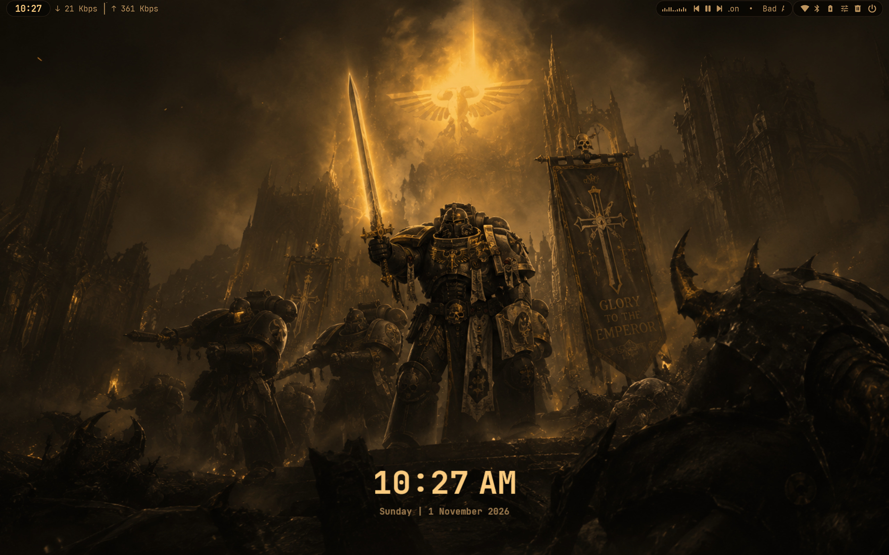

**A gruvbox-dark, gold-accented Windows 11 rice: top bar, floating dock, tiling, a keyboard-driven
launcher and translucent Explorer, all running on top of the normal Windows shell.**


[Gallery](#gallery) · [What's inside](#whats-inside) · [Install](#installation) ·
[Manual install](MANUAL-INSTALL.md) · [Keybindings](#keybindings) · [Customising](#customising)

</div>

---

> [!IMPORTANT]
> **GruvGold is meant to be seen through Windows Night Light.** It was built and tuned with Night
> Light on at its default strength (48, about 3950 K), which gives it its warm, amber look. Without
> Night Light the same colours look noticeably colder.
>
> - **Every screenshot in this repository has that Night Light tint applied**, matching what you
>   see on screen with Night Light on. Screenshots never capture Night Light, so the tint was added
>   afterwards with the same colour shift (red ×1.00, green ×0.85, blue ×0.64).
> - **The install script uses `theme/wallpaper-warm.png`**, the wallpaper with that tint baked in,
>   so the rice looks right even with Night Light off. The original `theme/wallpaper.png` is kept
>   alongside it.
> - **If you keep Night Light on**, the warm wallpaper would be tinted twice. Apply with
>   `.\scripts\apply.ps1 -NeutralWallpaper` to use the original instead.
> - Only the wallpaper can be pre-tinted. For the full effect on the bar, terminal and every app,
>   turn Night Light on (Settings → System → Display → Night light).

---

## Gallery

<table>
  <tr>
    <td width="50%">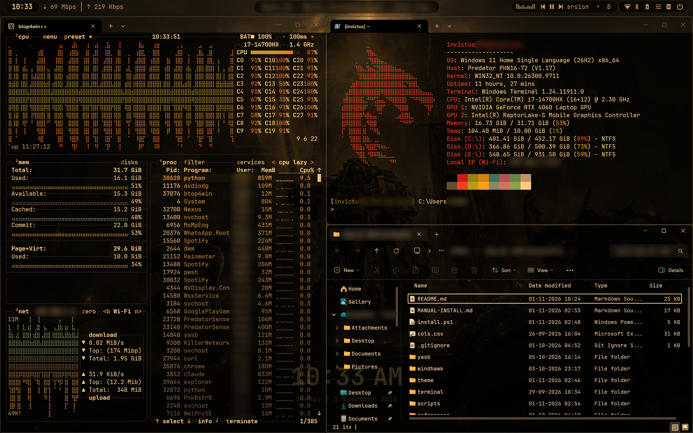<br><sub><b>Tiling</b>: komorebi with btop, the terminal and Explorer</sub></td>
    <td width="50%">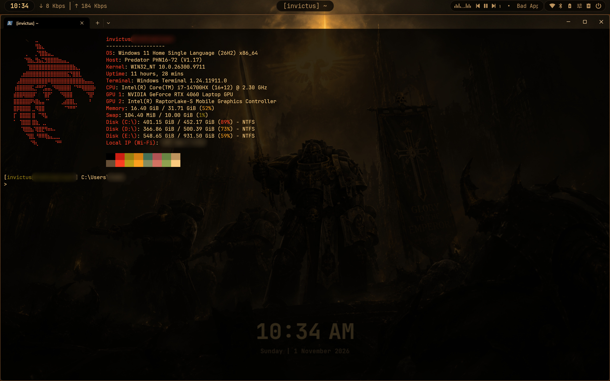<br><sub><b>Terminal</b>: translucent Windows Terminal, fastfetch greeting, plain PowerShell prompt</sub></td>
  </tr>
  <tr>
    <td width="50%">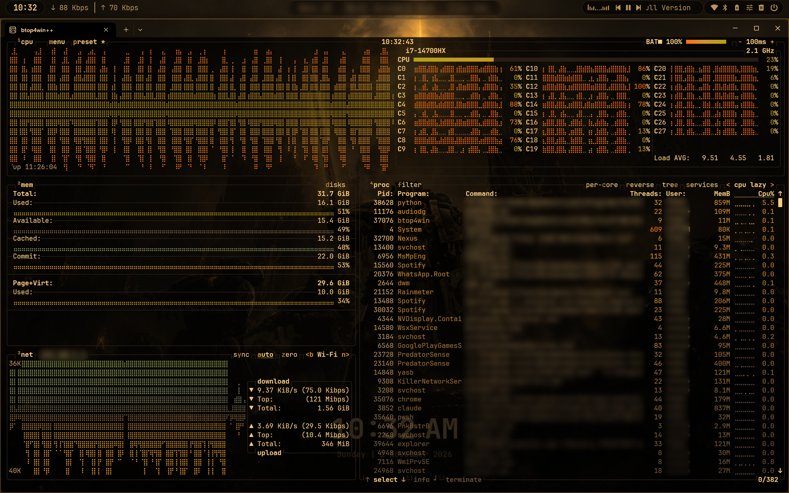<br><sub><b>btop</b>: the system monitor in the GruvGold theme</sub></td>
    <td width="50%">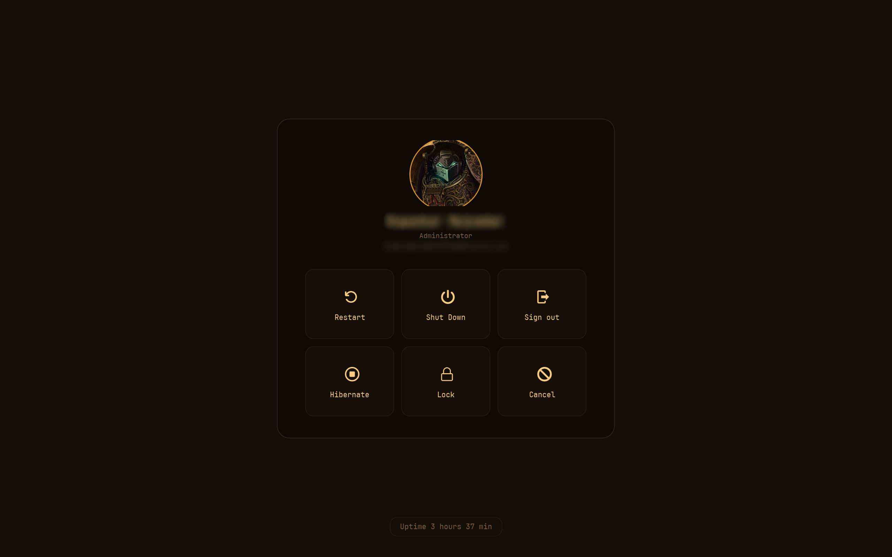<br><sub><b>Power menu</b>: full-screen, from the bar</sub></td>
  </tr>
  <tr>
    <td width="50%">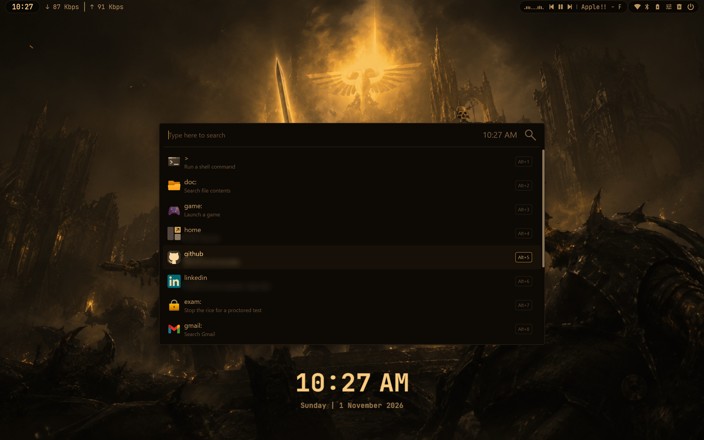<br><sub><b>Launcher</b>: Flow Launcher's home list, opened with a tap of <kbd>Win</kbd></sub></td>
    <td width="50%">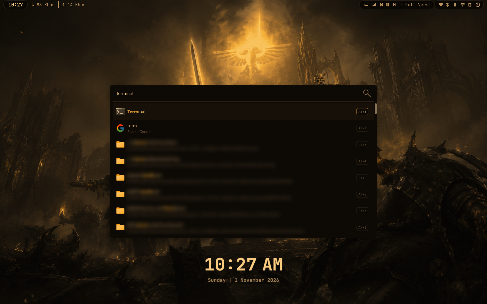<br><sub><b>Search</b>: apps, web and instant file search through Everything</sub></td>
  </tr>
  <tr>
    <td width="50%">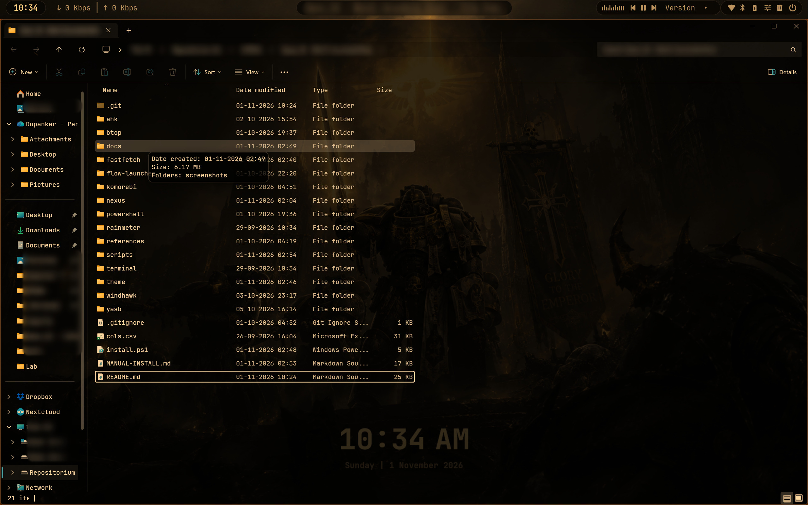<br><sub><b>Explorer</b>: translucent, in JetBrains Mono, with the details tooltip</sub></td>
    <td width="50%">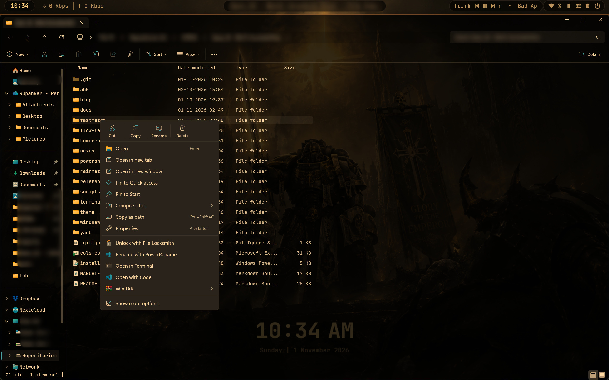<br><sub><b>Context menus</b> pick up the same dark tint</sub></td>
  </tr>
  <tr>
    <td colspan="2">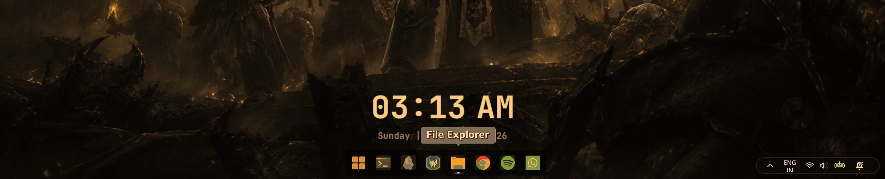<br><sub><b>Dock and tray pill</b>: the Nexus dock (gruvbox-graded icons) centred at the bottom, the clock above it, and the native tray reduced to a pill in the corner</sub></td>
  </tr>
  <tr>
    <td width="50%">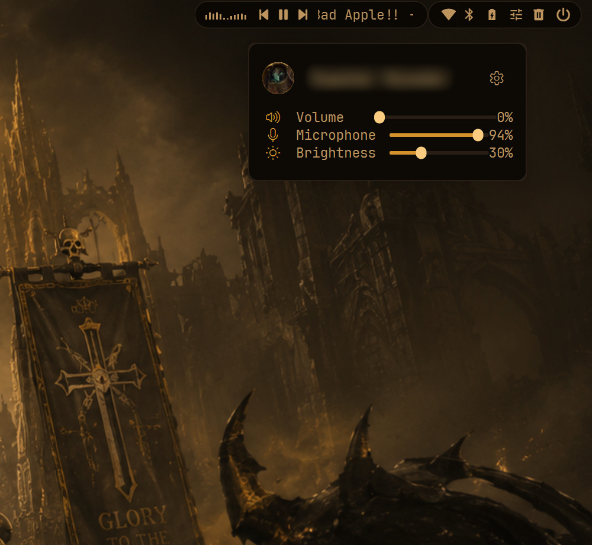<br><sub><b>Control centre</b>: volume, microphone and brightness</sub></td>
    <td width="50%">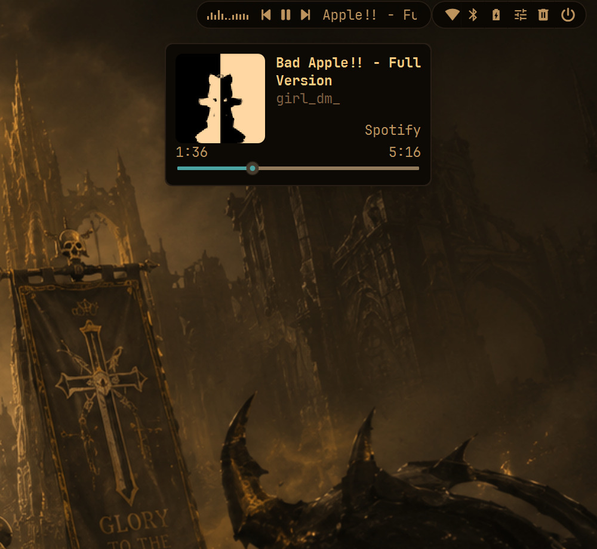<br><sub><b>Media</b>: the now-playing card from the media pill</sub></td>
  </tr>
  <tr>
    <td width="50%">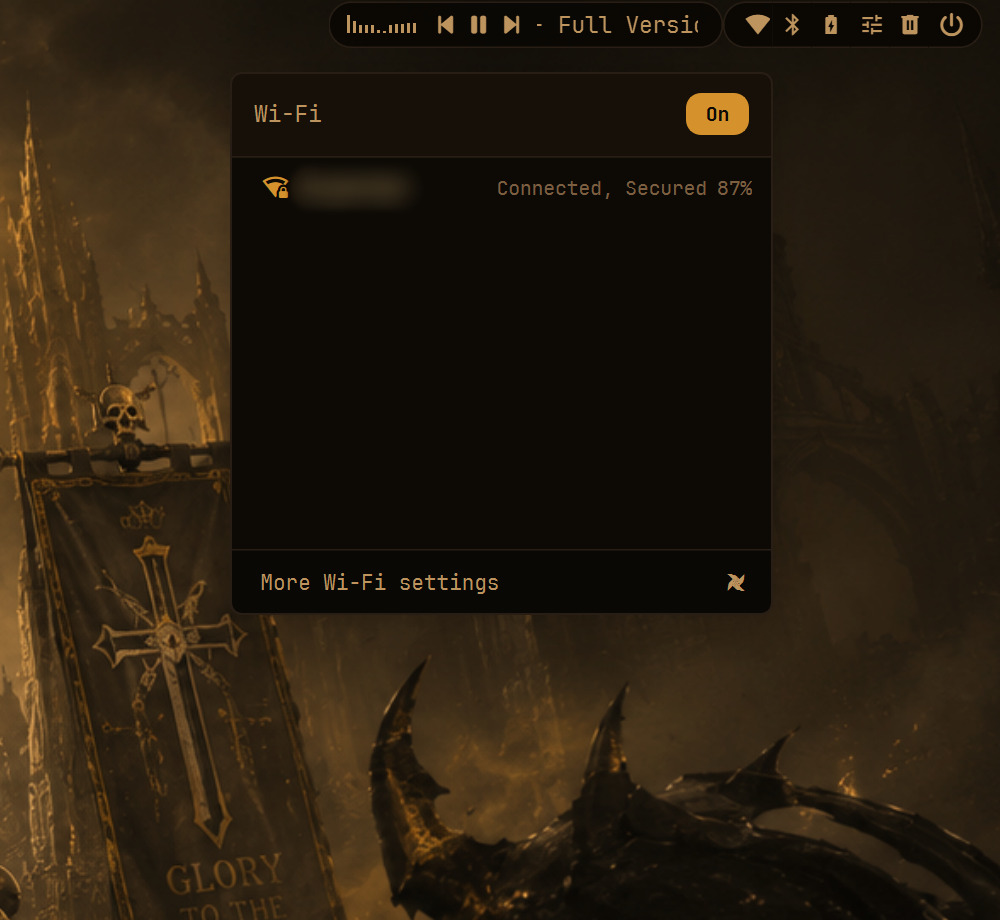<br><sub><b>Wi-Fi</b>: networks, with an on/off switch</sub></td>
    <td width="50%">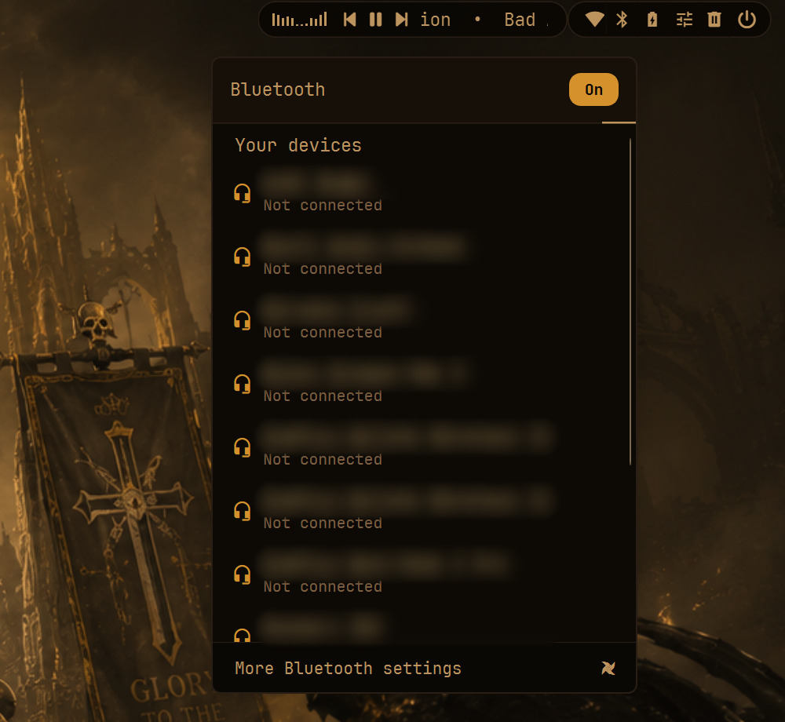<br><sub><b>Bluetooth</b>: paired devices, with an on/off switch</sub></td>
  </tr>
</table>

Personal details (names, accounts, network names, addresses) are blurred in the screenshots.

---

## What's inside

| | Tool | Config |
|---|---|---|
| Top bar | [YASB](https://github.com/amnweb/yasb) 2.0.7, patched | `yasb/` |
| Apps dock | [Nexus](https://www.winstep.net/nexus.html) | `nexus/configure-nexus.ps1` |
| Tray and notifications | native Windows taskbar, reduced to a pill by Windhawk's Taskbar Styler | `windhawk/apply-taskbar-styler.ps1` |
| Desktop clock | [Rainmeter](https://www.rainmeter.net/) | `rainmeter/` |
| Launcher | [Flow Launcher](https://www.flowlauncher.com/) + [Everything](https://www.voidtools.com/) | `flow-launcher/` |
| Tiling and hotkeys | [komorebi](https://github.com/LGUG2Z/komorebi) + whkd, [masir](https://github.com/LGUG2Z/masir) for hover-to-focus | `komorebi/` |
| Win key, desktop typing, snapping, Win+D | [AutoHotkey v2](https://www.autohotkey.com/) | `ahk/` |
| Terminal | Windows Terminal + plain PowerShell prompt + [fastfetch](https://github.com/fastfetch-cli/fastfetch) | `terminal/`, `powershell/`, `fastfetch/` |
| System monitor | [btop4win](https://github.com/aristocratos/btop4win) | `btop/` |
| Explorer | [Windhawk](https://windhawk.net) mods, loaded into `explorer.exe` only | `windhawk/` |
| Wallpaper, palette, avatar | | `theme/` |

**Top bar.** The clock and network traffic on the left, the active window's title in the centre, and
on the right the media pill (with its own audio bars), Wi-Fi, Bluetooth, battery, a control centre,
the Recycle Bin and a full-screen power menu. The only audio bars in the rice are the ones inside the
media pill; the desktop shows the clock alone.

**Bottom edge.** Two separate pieces. The *apps dock* is Nexus, centred and auto-hiding, revealed
from anywhere along the bottom edge. The *tray pill* is the real Windows taskbar with every button
hidden, so the tray, bell and Quick Settings keep working; it appears from the bottom-right corner
only.

**Tiling.** komorebi with a thin border on the focused window: blue-grey for a single window, gold
for a stack, orange in monocle. New windows join the focused stack, and hovering a window focuses
it.

**Nothing here modifies Windows itself.** No theme-signature patching, no `explorer.exe`
replacement, no system files touched. The one injection is Windhawk, limited to `explorer.exe`, and
the one modified app is YASB, whose own modules are patched (`yasb/patch-yasb.ps1 -Restore` puts the
stock ones back). `scripts/uninstall.ps1` restores every setting from a backup taken before install.

---

## Installation

### Requirements

- Windows 11 with `winget` (App Installer), and Windows PowerShell 5.1 (built in).
- Optional: Python 3 from python.org, only for the `exam:` launcher shortcut.
- Display scaling of 150% is what the bar sizes were tuned at; other scales work but may need
  tweaks in `yasb/styles.css`.

### Scripted install

From a PowerShell window:

```powershell
git clone https://github.com/InvictusRex/Win11-GruvGold-Rice.git
cd Win11-GruvGold-Rice
Set-ExecutionPolicy -Scope Process Bypass -Force   # allow the scripts for this session only

.\scripts\backup.ps1            # 1. snapshot what the rice changes (run elevated to also get a restore point)
.\install.ps1 -IncludeFont      # 2. install the apps and the JetBrainsMono Nerd Font
#    open Flow Launcher, Rainmeter, Everything and Windows Terminal once each so they create
#    their settings files, then open a NEW PowerShell window in the repo
.\scripts\apply.ps1             # 3. deploy the configs and Windows settings (sets the warm wallpaper)
#    in an ADMIN PowerShell:  .\yasb\patch-yasb.ps1
.\scripts\start.ps1 -Autostart  # 4. start everything now and at every login
```

Then, once, set up the Windhawk mods by hand (see [Windhawk](#windhawk)); Windhawk only installs mods
from its own window. Optionally, build the patched Flow plugin behind the launcher's fixed home list
([MANUAL-INSTALL.md, step 5](MANUAL-INSTALL.md#5-launcher-flow-launcher--everything)); without it Flow
shows its stock home list.

Every script is idempotent. `apply.ps1` says what it skipped and why (usually an app that has not
been opened yet); open that app and run it again.

`apply.ps1` copies, it never links: the clone is only the source. Configs go to where each app reads
them, and the scripts the rice runs later, the wallpaper and the avatar go to
`%LOCALAPPDATA%\GruvGoldRice`. Editing the clone changes nothing until you run `apply.ps1` again, and
the rice keeps working if the clone is moved or deleted.

### Manual install

Prefer to see and do every step yourself? **[MANUAL-INSTALL.md](MANUAL-INSTALL.md)** walks through
the same setup without running any of the scripts.

### Windhawk

Windhawk loads its mods into `explorer.exe` only and patches no file, so uninstalling it is a full
revert. Once, after `install.ps1`:

1. In Windhawk's settings leave "inject into games" and "critical processes" **off** (the defaults)
   and turn off mod auto-update.
2. **Translucent Windows**: in its Advanced tab set the custom process inclusion list to
   `explorer.exe` and tick *use only custom lists* (otherwise it loads into every process). Apply
   `windhawk/translucent-windows.patch` in the mod's editor and compile, then enter the values from
   `windhawk/translucent-windows.json`.
3. **Windows 11 File Explorer Styler**: theme `Translucent Explorer11`, translucent background
   effect `None`, plus the control styles in `windhawk/file-explorer-styler.json`.
4. **Explorer Font Changer**: apply `windhawk/explorer-font-changer.patch` (adds a *Font size
   scale* setting, and restores each caller's font after drawing so multi-line tooltips keep their
   size), compile, and use `windhawk/explorer-font-changer.json`.
5. **Windows 11 Taskbar Styler** (the tray pill): install it, then run
   `windhawk/apply-taskbar-styler.ps1` from an elevated PowerShell. Leave the mod's XAML diagnostics
   handling on *block*; Explorer has one XAML-diagnostics slot, so run no other taskbar-styling tool
   next to it.
6. Restart Explorer.

A hook that stops matching after a Windows update simply does not load. If Explorer misbehaves, quit
Windhawk from the tray, run `windhawk.exe -safe-mode`, or uninstall it from Settings → Apps.

### Uninstall

```powershell
.\scripts\uninstall.ps1                   # stop, remove configs, restore settings from the backup
.\scripts\uninstall.ps1 -RemovePackages   # ...and uninstall the apps (except ones you had before)
```

---

## Keybindings

### Launcher and desktop (AutoHotkey)

| Key | Action |
|---|---|
| <kbd>Win</kbd> tapped alone | Flow Launcher instead of the Start menu (tap again to close) |
| typing on the desktop | Flow Launcher with what you typed |
| hold <kbd>Space</kbd>, press <kbd>Enter</kbd> | Windows Terminal in your home folder |
| <kbd>Ctrl</kbd>+<kbd>Esc</kbd> | the real Start menu |
| <kbd>Ctrl</kbd>+<kbd>Alt</kbd>+<kbd>D</kbd> | suspend / resume the above |
| <kbd>Ctrl</kbd>+<kbd>C</kbd> inside btop | quit btop |

Every other <kbd>Win</kbd> combination (E, R, L, …) works as usual.

### Windows and tiling (komorebi via whkd)

The modifier is <kbd>Alt</kbd>, since Windows reserves most <kbd>Win</kbd> combinations.

| Key | Action |
|---|---|
| <kbd>Alt</kbd>+<kbd>h</kbd> <kbd>j</kbd> <kbd>k</kbd> <kbd>l</kbd> | focus left / down / up / right |
| <kbd>Alt</kbd>+<kbd>Shift</kbd>+<kbd>h</kbd> <kbd>j</kbd> <kbd>k</kbd> <kbd>l</kbd> | move window left / down / up / right |
| <kbd>Alt</kbd>+<kbd>Shift</kbd>+<kbd>Enter</kbd> | promote to the main tile |
| <kbd>Alt</kbd>+<kbd>[</kbd> / <kbd>]</kbd> | cycle focus previous / next |
| <kbd>Alt</kbd>+<kbd>-</kbd> / <kbd>=</kbd> | shrink / grow horizontally |
| <kbd>Alt</kbd>+<kbd>Shift</kbd>+<kbd>-</kbd> / <kbd>=</kbd> | shrink / grow vertically |
| <kbd>Alt</kbd>+<kbd>q</kbd> | close window |
| <kbd>Alt</kbd>+<kbd>f</kbd> | toggle monocle |
| <kbd>Alt</kbd>+<kbd>Shift</kbd>+<kbd>f</kbd> | toggle maximise |
| <kbd>Alt</kbd>+<kbd>t</kbd>, <kbd>Win</kbd>+<kbd>j</kbd> | toggle tiling for the workspace |
| <kbd>Alt</kbd>+arrow | stack onto the window in that direction |
| <kbd>Alt</kbd>+<kbd>Shift</kbd>+<kbd>u</kbd> | unstack |
| <kbd>Alt</kbd>+<kbd>`</kbd> | cycle through the stack |
| <kbd>Alt</kbd>+<kbd>Shift</kbd>+<kbd>b</kbd> <kbd>c</kbd> <kbd>r</kbd> <kbd>v</kbd> <kbd>t</kbd> | layout: BSP / columns / rows / vertical stack / ultrawide |
| <kbd>Alt</kbd>+<kbd>Shift</kbd>+<kbd>x</kbd> / <kbd>y</kbd> | flip the layout horizontally / vertically |
| <kbd>Alt</kbd>+<kbd>1</kbd>…<kbd>5</kbd> | switch to workspace 1–5 |
| <kbd>Alt</kbd>+<kbd>Shift</kbd>+<kbd>1</kbd>…<kbd>5</kbd> | move window to workspace 1–5 |
| <kbd>Win</kbd>+<kbd>Shift</kbd>+<kbd>←</kbd> / <kbd>→</kbd> | move window left / right |
| <kbd>Alt</kbd>+<kbd>Shift</kbd>+<kbd>q</kbd> | reload the komorebi config |
| <kbd>Alt</kbd>+<kbd>Shift</kbd>+<kbd>Esc</kbd> | stop komorebi and whkd |

### Snapping and Show Desktop (whkd → AutoHotkey)

| Key | First press | Second press |
|---|---|---|
| <kbd>Win</kbd>+<kbd>↑</kbd> | top half | fill the screen |
| <kbd>Win</kbd>+<kbd>↓</kbd> | bottom half | minimise |
| <kbd>Win</kbd>+<kbd>←</kbd> / <kbd>→</kbd> | left / right half | back into the tiling |
| <kbd>Win</kbd>+<kbd>D</kbd>, three-finger swipe down | minimise all windows (bar and clock stay) | restore them |

### Launcher keywords

The empty-query list holds `>` (shell command), `doc:` (file contents), `game:`, `home`, `github`,
`linkedin`, `exam:`, `gmail:`, `youtube:`, `translate:`, `maps:`, `sc:` (Google Scholar) and `btop`.
Anything that matches nothing falls through to a Google search.

---

## Scripts

`install.ps1` is at the repo root, everything else in `scripts/`. Run them from the repo root.

| Script | What it does |
|---|---|
| `scripts/backup.ps1` | Snapshots everything the rice changes into `%LOCALAPPDATA%\GruvGoldRice-backup\<timestamp>`: a System Restore point (elevated shells only), `.reg` exports of the keys it edits, the config files it overwrites, and the current wallpaper and taskbar state. |
| `install.ps1` | Installs the apps with winget and skips any already present. `-IncludeFont` adds the JetBrainsMono Nerd Font (machine-wide, asks for elevation). Changes no settings. |
| `scripts/apply.ps1` | Deploys every config and sets the Windows options. `-SkipSettings` deploys configs only, `-SkipConfigs` sets Windows options only, `-Name <name>` sets the name in the prompt and fastfetch, `-NeutralWallpaper` uses the untinted wallpaper. |
| `scripts/start.ps1` | Starts what is not running: Everything, Nexus, YASB, Flow Launcher, Rainmeter, the AutoHotkey hook, then komorebi, whkd and masir. `-Stop`, `-Restart`, `-NoTiling`, and `-Autostart` (adds one shortcut to the Startup folder). |
| `scripts/exam-mode.ps1` | Turns the rice fully off for a proctored test (AutoHotkey, Rainmeter and global input hooks are what proctoring tools look for), disables autostart, and stops and disables Windhawk's service (one UAC prompt). `-Off` brings everything back. Also available as `exam: on` / `exam: off` in any PowerShell. `disable.ps1` is the same script under a more general name. |
| `scripts/uninstall.ps1` | Stops everything, deletes the deployed configs, restores the backup. `-RemovePackages` also uninstalls the apps, except those installed before `backup.ps1` ran. `-From <timestamp>` restores a specific backup. |

<details>
<summary><b>What <code>apply.ps1</code> changes, step by step</b></summary>

**Configs** (skipped with `-SkipConfigs`):

1. **YASB**: `config.yaml` and `styles.css`; the avatar goes to `%LOCALAPPDATA%\GruvGoldRice\theme`
   and its absolute path is written into the config. Reports whether the YASB patches are in place.
2. **Nexus**: runs `nexus/configure-nexus.ps1`, which writes the dock settings and pins into Nexus'
   registry key and generates the gruvbox-graded pin icons. Store apps are pinned by their AUMID,
   since their install folder changes with every update. Edit `pinSpecs` in that script for your
   own apps; pins for apps that are not installed are skipped.
3. **komorebi + whkd**: `komorebi.json`, `whkdrc`, and the community `applications.json` rule set.
4. **Flow Launcher**: the GruvGold theme, a 1000px window with 8 results, file and path search
   through Everything (AppData, dot-folders and dotfiles in your profile excluded from the index),
   web searches trimmed to the keywords above, Browser Bookmarks off, duplicate Windows apps merged,
   the fixed home list, and the ExamMode and Btop plugins (if Python is installed).
5. **Auto-updates off** for Rainmeter and PowerShell 7's update notice.
6. **Windows Terminal**: the GruvGold colour scheme as a fragment, then 80% opacity, JetBrainsMono NF
   11pt, a transparent tab row, and `-NoLogo` for both PowerShell profiles.
7. **PowerShell + fastfetch**: the prompt script and one dot-source line in each profile; the
   fastfetch config with your name and local drives filled in.
8. **btop**: the theme and config.
9. **Rainmeter**: the clock skin, positioned bottom-centre.
10. **AutoHotkey and rice scripts** to `%LOCALAPPDATA%\GruvGoldRice`.

**Windows settings** (skipped with `-SkipSettings`): the wallpaper (`wallpaper-warm.png`, or
`wallpaper.png` with `-NeutralWallpaper`) on the desktop and lock screen, dark mode, the accent
window border off (komorebi draws the focus border), drag-to-edge snapping on, the taskbar centred
and auto-hidden (so the tray pill only appears from the corner), native Win+D off, the touchpad three-finger swipe down mapped to Win+D, and an
Explorer restart.

</details>

<details>
<summary><b>Where everything goes</b></summary>

| Deployed | Location |
|---|---|
| YASB config and styles | `~\.config\yasb\` |
| YASB patched modules | inside `C:\Program Files\YASB\lib\library.zip` (stock copy kept as `library.zip.gruvgold-backup`) |
| `komorebi.json` | `~\komorebi.json` |
| `whkdrc` | `~\.config\whkdrc` |
| komorebi `applications.json` | `~\.config\komorebi\` |
| Flow Launcher theme, plugins, home list | `%APPDATA%\FlowLauncher\` |
| Terminal colour scheme | `%LOCALAPPDATA%\Microsoft\Windows Terminal\Fragments\GruvGold\` |
| Terminal defaults and tab-row theme | merged into Terminal's own `settings.json` |
| PowerShell prompt | `~\.config\powershell\gruvgold.ps1`, plus one line in each profile |
| fastfetch config and logo | `~\.config\fastfetch\` |
| btop theme and config | `~\.config\btop\themes\` and next to `btop4win.exe` |
| Rainmeter clock | `~\Documents\Rainmeter\Skins\GruvGold\` |
| AutoHotkey scripts, `start.ps1`, `exam-mode.ps1`, wallpaper, avatar, dock icons | `%LOCALAPPDATA%\GruvGoldRice\` |
| Nexus settings and pins | `HKCU\Software\WinSTEP2000\NeXuS` |
| Autostart shortcut | `shell:startup\GruvGold - Startup.lnk` |
| Backups | `%LOCALAPPDATA%\GruvGoldRice-backup\` |

</details>

---

## Customising

- **Name in the prompt and fastfetch**: `.\scripts\apply.ps1 -Name <name>` (remembered in the
  `GRUVGOLD_NAME` user variable). The default is your Windows user name.
- **Anything else**: edit the file in the clone, run `.\scripts\apply.ps1 -SkipSettings`, then
  `.\scripts\start.ps1 -Restart` if a running app needs to reload.
- **Wallpaper and avatar**: replace `theme/wallpaper.png` and `theme/profile.png`. If you replace
  the wallpaper, also replace `theme/wallpaper-warm.png` with a warm copy of it (scale green by 0.85
  and blue by 0.64 in any image editor), or apply with `-NeutralWallpaper`.
- **Dock pins**: `pinSpecs` in `nexus/configure-nexus.ps1`.
- **Launcher home list**: the `$homeEntries` list in `scripts/apply.ps1`; the `home`, `github` and
  `linkedin` entries point at the author's pages, so change them to yours.
- **Keybindings**: `komorebi/whkdrc` and `ahk/desktop-type-to-launch.ahk`.
- **Colours**: `theme/palette.json` is the reference; each component keeps its own copy of the
  values (YASB `styles.css`, `GruvGold.xaml`, the Terminal fragment, btop, the Rainmeter clock, and
  the komorebi borders in `scripts/start.ps1`), so change them there too.

### Palette

| Token | Hex | Role |
|---|---|---|
| `bg` | `#000000` | base, bar background |
| `bg_alt` | `#0D0C09` | card and panel surface |
| `bg_elev` | `#16130D` | hover, selected row |
| `border` | `#282421` | hairlines |
| `fg` | `#FBF1C7` | primary text |
| `fg_dim` | `#BDAE93` | secondary text |
| `fg_muted` | `#7C6F64` | placeholder |
| `gold` | `#D5AC45` | accent |
| `gold_dim` | `#D1A433` | accent pressed |

The colours were sampled from a screenshot of an Obsidian theme rather than picked by eye
(`cols.csv` holds the samples). Font: **JetBrainsMono NF** everywhere.

---

## Repository layout

```
install.ps1              winget installs
MANUAL-INSTALL.md        the same setup by hand, without the scripts
scripts/                 backup, apply, start, exam-mode (+ disable), uninstall
theme/                   palette.json, wallpaper.png, wallpaper-warm.png, profile.png
docs/screenshots/        README images (Night Light tint applied, personal details blurred)
ahk/                     Win key / desktop typing / Space+Enter, snapping, Win+D
btop/                    btop theme and config
fastfetch/               fastfetch config and the dragon logo
flow-launcher/           theme, icons, ExamMode and Btop plugins, Plugin Indicator patch
komorebi/                komorebi.json, whkdrc
nexus/                   dock configuration script and logo
powershell/              prompt, greeting, exam:, btop alias
rainmeter/               desktop clock skin
terminal/                Windows Terminal colour scheme fragment
windhawk/                Explorer mod settings and patches, Taskbar Styler script
yasb/                    bar config and styles, patched YASB modules and patch-yasb.ps1
cols.csv                 colour samples behind the palette
```

---

## Known issues and notes

- **Win+D is reimplemented.** On Windows 11 24H2 the native Show Desktop minimises always-on-top
  bars like YASB and does not reliably bring them back (amnweb/yasb#62). `toggle-desktop.ahk`
  minimises ordinary windows itself and never touches the bar or the clock.
- **komorebi reads some settings unreliably.** It ignores the border colours in `komorebi.json` and
  does not always apply ignore rules to 32-bit game launchers, so `start.ps1` sets both over the CLI.
  Run `start.ps1 -Restart` rather than only reloading the komorebi config if borders look wrong.
- **Accent colour.** Windows regenerates it at every sign-in, so the rice turns the accent window
  border off and lets komorebi draw the focus border.
- **`Alt+Shift+R` is bound twice** in `whkdrc` (rows layout and `retile`); only one fires.
- **Flow content search (`doc:`)** stays on the Windows index; Everything's content search
  reproducibly hung Flow's search engine.
- **Bottom edge.** Outside the bottom-right corner the pointer stops 3 pixels short of the screen
  edge, which keeps the tray pill out of the dock's reveal zone. <kbd>Ctrl</kbd>+<kbd>Alt</kbd>+<kbd>D</kbd>
  suspends this along with desktop typing.
- **Desktop typing** replaces Explorer's "jump to the icon starting with that letter".
- **Display scaling.** YASB sizes are logical pixels tuned at 150%.
- **fastfetch disks** are listed explicitly (filled in by `apply.ps1`), because automatic detection
  also probes mapped network drives and stalls when one is disconnected. Re-run `apply.ps1` after
  adding a drive.
- **Lock screen.** The wallpaper is set on the lock screen too; its clock keeps the Windows font.

---

## Credits

[YASB](https://github.com/amnweb/yasb) · [komorebi, whkd and masir](https://github.com/LGUG2Z) ·
[Flow Launcher](https://www.flowlauncher.com/) · [Everything](https://www.voidtools.com/) ·
[Winstep Nexus](https://www.winstep.net/nexus.html) · [Rainmeter](https://www.rainmeter.net/) ·
[AutoHotkey](https://www.autohotkey.com/) · [Windhawk](https://windhawk.net) and its mod authors ·
[fastfetch](https://github.com/fastfetch-cli/fastfetch) · [btop4win](https://github.com/aristocratos/btop4win) ·
[JetBrains Mono](https://www.jetbrains.com/lp/mono/) · [gruvbox](https://github.com/morhetz/gruvbox)
